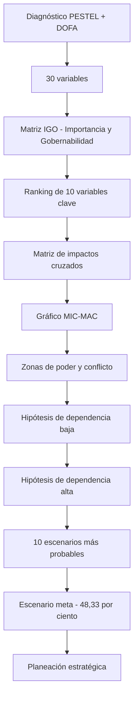

# Análisis Prospectivo de Imaginamos S.A.S. – Horizonte 2036 – Pensamiento Estratégico y Prospectiva – Matriz IGO, Impactos Cruzados, MIC-MAC, Hipótesis y Escenario Meta

---

Este repositorio contiene el estudio de prospectiva estratégica de **Imaginamos S.A.S.**, empresa bogotana de transformación digital fundada en 2007. El análisis se desarrolló con el **Software de Análisis Prospectivo del Politécnico Grancolombiano**, bajo el enfoque de la escuela francesa de prospectiva (**Michel Godet**), con un horizonte **2026–2036**. Recorre todas las etapas del método, desde el diagnóstico estratégico y la identificación de variables hasta la construcción del escenario meta que orienta la planeación de la compañía.

---

## Contenido del repositorio

**`docs/`**
- `docs/Desarrollo_U1_Pensamiento_Estrategico_y_Prospectiva.pdf` → Informe final de la actividad: diagnóstico PESTEL y DOFA, análisis de variables, MIC-MAC, hipótesis, escenarios y conclusiones.
- `docs/Diploma didáctico.pdf` → Diploma de finalización de la simulación en el software de prospectiva.

**`simulador/resultados/`**
- `simulador/resultados/VariablesIniciales.xlsx` → Listado de las 30 variables iniciales con su calificación de importancia y gobernabilidad.
- `simulador/resultados/RankingVariables.xlsx` → Ranking de las 10 variables clave seleccionadas a partir de la matriz IGO.
- `simulador/resultados/PoderConflicto.xlsx` → Valores de motricidad y dependencia, y clasificación de las variables por zonas del plano MIC-MAC.
- `simulador/resultados/MatrizHipotesisDepBaja.xlsx` → Hipótesis formuladas para las variables de dependencia baja.
- `simulador/resultados/MatrizHipotesisDepAlta.xlsx` → Hipótesis formuladas para las variables de dependencia alta.
- `simulador/resultados/ListaEscenarioMeta.xlsx` → Los 10 escenarios más probables generados por el simulador y su probabilidad.
- `simulador/resultados/Escenario_Meta.xlsx` → Detalle del escenario meta seleccionado (48,33 %).
- `simulador/resultados/GraficaMicMac.png` → Gráfico MIC-MAC de motricidad frente a dependencia.

**`simulador/herramientas/`**
- `simulador/herramientas/Simulador_Prospectiva_Imaginamos.xlsm` → Software de análisis prospectivo diligenciado para Imaginamos (requiere habilitar macros).
- `simulador/herramientas/Matriz_IGO_Imaginamos.xlsx` → Matriz IGO de soporte con los cálculos de importancia y gobernabilidad.

**`evidencias/`**
- `evidencias/Simulador imagen 1.png` … `evidencias/Simulador imagen 31.png` → 31 capturas que documentan, paso a paso, el uso del simulador.

---

## Arquitectura del análisis

---

## Metodología

- **Matriz IGO (Importancia y Gobernabilidad):** la **importancia** de cada variable se calcula a partir de su **probabilidad** de ocurrencia, la **magnitud** de su efecto y su **impacto financiero** en la organización. La **gobernabilidad** mide el grado de control que Imaginamos tiene sobre la variable. Al cruzar ambos ejes se priorizan las variables y se obtiene el ranking de las 10 variables clave.
- **Matriz de impactos cruzados:** cada par de variables clave se califica en una escala de **0 a 3**, donde **0** significa sin influencia, **1** influencia débil, **2** influencia moderada y **3** influencia fuerte. Siguiendo la convención del simulador, la suma de cada fila da la **dependencia** de la variable y la suma de cada columna, su **influencia** (motricidad) sobre el sistema.
- **Lectura del MIC-MAC:** el plano de motricidad frente a dependencia ubica cada variable en una zona:
  - **Zona de poder** (alta motricidad, baja dependencia): variables que condicionan el sistema.
  - **Zona de conflicto** (alta motricidad, alta dependencia): variables inestables que influyen en el sistema y a la vez reciben su influencia.
  - **Zona de resultado** (baja motricidad, alta dependencia): variables que reflejan el comportamiento del sistema.
  - **Zona autónoma** (baja motricidad, baja dependencia): variables con poca relación con el resto.
- **Hipótesis y escenarios:** se formulan hipótesis para las variables de dependencia baja y alta. El simulador combina sus probabilidades para generar los 10 escenarios más probables y, entre ellos, se elige el **escenario meta**.

---

## Resultados clave

- **Variables con mayor importancia:** *Ingresos concentrados en proyectos a la medida* e *IA generativa en el desarrollo de software*.
- **Zona de poder:** *Digitalización de pymes y consumidores*.
- **Zona de conflicto:** *IA generativa*, *Nearshoring*, *Brecha de talento TI*, *Ciberseguridad*, *Cartera de clientes*, *Presencia internacional*, *Trabajo remoto* y *Escala*.
- **Variable de resultado:** *Ingresos concentrados en proyectos a la medida* (dependencia 18).
- **Escenario meta (48,33 %):** digitalización masiva, adopción plena de IA, auge del nearshoring, madurez en ciberseguridad, rotación controlada y brecha de talento persistente.

---

## Cómo revisar el proyecto

1. Abrir el informe final `docs/Desarrollo_U1_Pensamiento_Estrategico_y_Prospectiva.pdf` para leer el análisis completo.
2. Revisar los archivos Excel de `simulador/resultados/`, que contienen las salidas de cada etapa del simulador.
3. Ver el gráfico `simulador/resultados/GraficaMicMac.png` para ubicar las variables en las zonas de poder, conflicto, resultado y autonomía.
4. Revisar las capturas de `evidencias/`, que muestran el proceso completo en el simulador.
5. Abrir `simulador/herramientas/Simulador_Prospectiva_Imaginamos.xlsm` en Microsoft Excel y **habilitar las macros** para explorar el simulador diligenciado.

---

## Evidencias incluidas

- **31 capturas del simulador** (`Simulador imagen 1.png` a `Simulador imagen 31.png`), que cubren el proceso completo: registro de las variables iniciales, calificación IGO, ranking, matriz de impactos cruzados, gráfico MIC-MAC, formulación de hipótesis, generación de escenarios y selección del escenario meta.
- **Informes descargados de cada etapa:** variables iniciales, ranking, poder y conflicto, hipótesis de dependencia baja y alta, lista de escenarios y escenario meta (`simulador/resultados/`).
- **Diploma de finalización de la simulación** (`docs/Diploma didáctico.pdf`).

---

## Autores

Este proyecto fue desarrollado en el marco del módulo **Pensamiento Estratégico y Prospectiva** del **Politécnico Grancolombiano**, bajo la orientación de la docente **Marcela Garzón Posada**.

- ***Alejandro De Mendoza*** – [Perfil GitHub](https://github.com/AlejoTechEngineer)
- ***Andres Alexis Tinoco Bohorquez***

---
