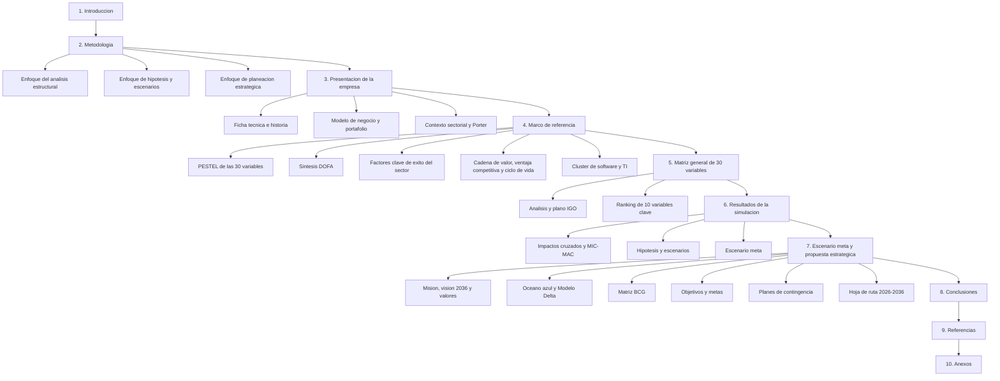
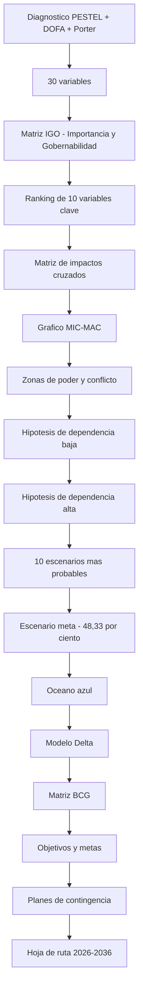
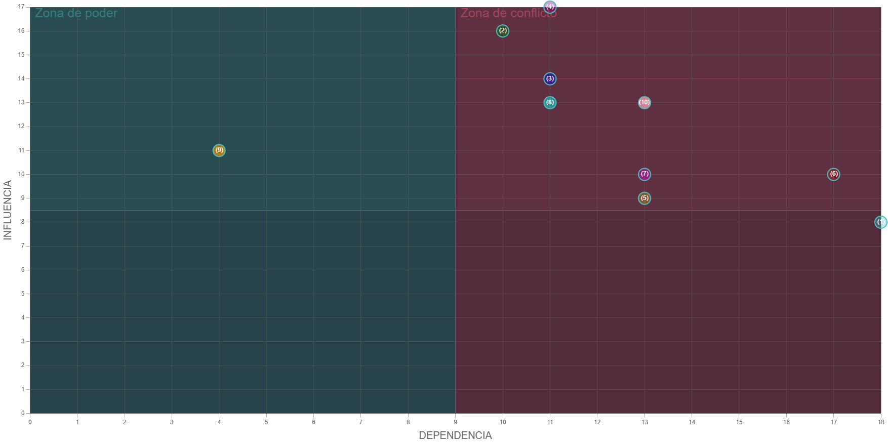
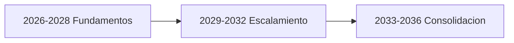

# 🔭 Análisis Prospectivo de Imaginamos S.A.S. – Horizonte 2036

### *Matriz IGO, Impactos Cruzados, MIC-MAC, Hipótesis, Escenario Meta y Propuesta Estratégica*

**Módulo: Pensamiento Estratégico y Prospectiva · Politécnico Grancolombiano · Unidad 1**

**[Contexto](#-contexto-y-alcance) • [Contenido](#-contenido-del-repositorio) • [Herramientas](#-herramientas-utilizadas) • [Arquitectura](#-arquitectura-del-análisis) • [Resultados](#-resultados-clave) • [Entrega 2](#-segunda-entrega-propuesta-estratégica) • [Autores](#-autores)**

---

## 📋 Tabla de Contenidos

- [🎯 Contexto y Alcance](#-contexto-y-alcance)
- [📁 Contenido del Repositorio](#-contenido-del-repositorio)
- [🧰 Herramientas Utilizadas](#-herramientas-utilizadas)
- [📐 Estructura del Informe](#-estructura-del-informe)
- [🔁 Arquitectura del Análisis](#-arquitectura-del-análisis)
- [🧭 Metodología](#-metodología)
- [📊 Resultados Clave](#-resultados-clave)
- [🗺️ Variables Clave en el Plano MIC-MAC](#️-variables-clave-en-el-plano-mic-mac)
- [🚀 Segunda Entrega: Propuesta Estratégica](#-segunda-entrega-propuesta-estratégica)
- [📄 Cómo Revisar el Proyecto](#-cómo-revisar-el-proyecto)
- [✅ Evidencias Incluidas](#-evidencias-incluidas)
- [📝 Nota](#-nota)
- [⚖️ Licencia](#️-licencia)
- [👥 Autores](#-autores)

---

## 🎯 Contexto y Alcance

Este repositorio contiene el estudio de prospectiva estratégica del **Grupo 9** sobre **Imaginamos S.A.S.**, empresa bogotana de transformación digital fundada en 2007. El estudio se desarrolló con el **Software de Análisis Prospectivo del Politécnico Grancolombiano**, bajo el enfoque de la escuela francesa de prospectiva (**Michel Godet**), con horizonte **2026–2036**.

El trabajo parte de un diagnóstico estratégico de la empresa y su entorno, identifica las variables que pueden transformar su posición competitiva y las prioriza. Luego analiza sus relaciones de influencia y dependencia, y construye el **escenario meta** que orienta la planeación estratégica de la compañía a diez años.

> **Empresa:** Imaginamos S.A.S. — desarrollo de software y transformación digital (Bogotá, Colombia).
> **Enfoque:** prospectiva estratégica, escuela francesa (Michel Godet).
> **Alcance:** 30 variables iniciales → 10 variables clave → análisis estructural MIC-MAC → hipótesis → escenario meta con probabilidad del **48,33 %** → propuesta estratégica a 2036 (Entrega 2).

### 🌟 ¿Qué aporta este estudio?

- 🔍 **Diagnóstico estratégico** de la empresa con PESTEL, DOFA y las cinco fuerzas de Porter.
- 🎯 **Priorización objetiva** de 30 variables mediante la matriz IGO (importancia y gobernabilidad).
- 🕸️ **Análisis estructural** con matriz de impactos cruzados y plano MIC-MAC.
- 🔮 **Construcción de escenarios** a partir de hipótesis de dependencia baja y alta.
- 🧭 **Escenario meta** como punto de partida para la planeación estratégica a 2036.
- 🚀 **Propuesta estratégica** (Entrega 2): océano azul, Modelo Delta, matriz BCG, objetivos estratégicos, planes de contingencia y hoja de ruta 2026-2036.

---

## 📁 Contenido del Repositorio

<table align="center">
  <tr><th>Elemento</th><th>Descripción</th></tr>
  <tr><td colspan="2"><b>📂 docs/</b></td></tr>
  <tr><td><code>Entrega_Proyecto_1_Imaginamos_Grupo_9.pdf</code></td><td>📘 Informe final de la Entrega 1 del Grupo 9: presentación de la empresa, matriz de 30 variables, análisis IGO, resultados de la simulación, conclusiones y anexos</td></tr>
  <tr><td colspan="2"><b>📂 segunda-entrega/</b></td></tr>
  <tr><td><code>Desarrollo_U1_Pensamiento_Estrategico_y_Prospectiva_Actividad_No_2.pdf</code></td><td>🚀 Informe final de la segunda entrega: marco de referencia, metodología ampliada, escenario meta y propuesta estratégica (océano azul, Modelo Delta, matriz BCG, objetivos, planes de contingencia y hoja de ruta 2026-2036)</td></tr>
  <tr><td><code>README.md</code></td><td>📄 Descripción de la carpeta y del contenido de la segunda entrega</td></tr>
  <tr><td colspan="2"><b>📂 simulador/resultados/</b></td></tr>
  <tr><td><code>Diploma_didáctico.pdf</code></td><td>🎓 Constancia de finalización de la simulación individual (9 de octubre de 2026)</td></tr>
  <tr><td><code>VariablesIniciales.xlsx</code></td><td>📋 Las 30 variables iniciales con su calificación de importancia y gobernabilidad</td></tr>
  <tr><td><code>RankingVariables.xlsx</code></td><td>🏆 Ranking de las 10 variables clave</td></tr>
  <tr><td><code>PoderConflicto.xlsx</code></td><td>⚖️ Influencia y dependencia de cada variable, y su zona en el plano MIC-MAC</td></tr>
  <tr><td><code>MatrizHipotesisDepBaja.xlsx</code></td><td>🔹 Hipótesis de las variables de dependencia baja</td></tr>
  <tr><td><code>MatrizHipotesisDepAlta.xlsx</code></td><td>🔸 Hipótesis de las variables de dependencia alta</td></tr>
  <tr><td><code>ListaEscenarioMeta.xlsx</code></td><td>🔮 Los 10 escenarios más probables y su probabilidad</td></tr>
  <tr><td><code>Escenario_Meta.xlsx</code></td><td>🎯 Detalle del escenario meta seleccionado (48,33 %)</td></tr>
  <tr><td><code>GraficaMicMac.png</code></td><td>📈 Gráfico MIC-MAC de influencia frente a dependencia</td></tr>
  <tr><td colspan="2"><b>📂 simulador/herramientas/</b></td></tr>
  <tr><td><code>Simulador_Prospectiva_Imaginamos.xlsm</code></td><td>🧮 Simulador de prospectiva diligenciado para Imaginamos (requiere habilitar macros)</td></tr>
  <tr><td><code>Matriz_IGO_Imaginamos.xlsx</code></td><td>📊 Matriz IGO de soporte con los cálculos de importancia y gobernabilidad</td></tr>
  <tr><td colspan="2"><b>📂 evidencias/</b></td></tr>
  <tr><td><code>Simulador imagen 1.png</code> … <code>Simulador imagen 31.png</code></td><td>📸 31 capturas que documentan paso a paso el uso del simulador</td></tr>
  <tr><td colspan="2"><b>📂 raíz</b></td></tr>
  <tr><td><code>README.md</code></td><td>📄 Este documento</td></tr>
  <tr><td><code>LICENSE</code></td><td>⚖️ Licencia MIT</td></tr>
  <tr><td><code>.gitignore</code></td><td>🚫 Mantiene en local los documentos editables (<code>.docx</code>, <code>.doc</code>), el material del curso y los temporales de Office</td></tr>
</table>

> ℹ️ El repositorio versiona **los informes en PDF de las entregas 1 y 2, los resultados y las herramientas del simulador, y las evidencias**. Las versiones editables en Word (`.docx`), incluida la de la segunda entrega, siguen excluidas vía `.gitignore`, al igual que los enunciados y el material del curso, y permanecen solo en local.

---

## 🧰 Herramientas Utilizadas

| Componente | Uso |
|:---|:---|
| **Software de Análisis Prospectivo (Politécnico Grancolombiano)** | Ingreso de variables, ranking, impactos cruzados, MIC-MAC, hipótesis y escenarios |
| **Microsoft Excel (.xlsm con macros)** | Ejecución del simulador y exportación de los informes de cada etapa |
| **Matriz IGO** | Priorización de las 30 variables según importancia y gobernabilidad |
| **PESTEL · DOFA · Cinco fuerzas de Porter** | Diagnóstico estratégico de la empresa y su entorno |
| **Factores clave de éxito · Ventaja competitiva · Cadena de valor · Clústeres** | Marco de referencia del sector (Entrega 2) |
| **Océanos rojos y azules · Modelo Delta · Matriz BCG · Ejes de Schwartz** | Formulación de la propuesta estratégica (Entrega 2) |
| **Mermaid** | Diagramas de estructura y de flujo de este README |

---

## 📐 Estructura del Informe

---

## 🔁 Arquitectura del Análisis

---

## 🧭 Metodología

| Etapa | Descripción |
|:---|:---|
| **Matriz IGO – Importancia** | Promedio de tres subcriterios en escala de 1 a 5: **probabilidad** de que la tendencia se manifieste, **magnitud** del cambio sobre la posición competitiva y **impacto financiero** esperado |
| **Matriz IGO – Gobernabilidad** | Grado de control que Imaginamos tiene sobre cada variable. Al cruzarla con la importancia se obtiene el ranking de las 10 variables clave |
| **Matriz de impactos cruzados** | Cada par de variables se califica de **0 a 3**: 0 sin influencia, 1 débil, 2 moderada y 3 fuerte. Siguiendo la convención del simulador, la suma de cada fila da la **dependencia** y la de cada columna, la **influencia** |
| **Plano MIC-MAC** | Ubica cada variable según su influencia y dependencia: **poder** (alta influencia, baja dependencia), **conflicto** (ambas altas), **salida o resultado** (baja influencia, alta dependencia) y **autónoma** (ambas bajas) |
| **Hipótesis y escenarios** | Se formulan hipótesis para las variables de dependencia baja y alta. El simulador combina sus probabilidades, genera los 10 escenarios más probables y se elige el **escenario meta** |
| **Planeación estratégica** | A partir del escenario meta se formulan la misión, la visión 2036, los objetivos estratégicos, los planes de contingencia y la hoja de ruta (Entrega 2) |

---

## 📊 Resultados Clave

| Hallazgo | Resultado |
|:---|:---|
| 🥇 **Variables con mayor importancia** | Ingresos concentrados en proyectos a la medida · IA generativa en el desarrollo de software |
| 💪 **Zona de poder** | Digitalización de pymes y consumidores |
| ⚡ **Zona de conflicto** | IA generativa · Nearshoring · Brecha de talento TI · Ciberseguridad · Cartera de clientes · Presencia internacional · Trabajo remoto · Escala |
| 🎯 **Variable de resultado** | Ingresos concentrados en proyectos a la medida (dependencia 18) |
| 🔮 **Escenario meta (48,33 %)** | Digitalización masiva · Adopción plena de IA · Auge del nearshoring · Madurez en ciberseguridad · Rotación controlada · Brecha de talento persistente |

---

## 🗺️ Variables Clave en el Plano MIC-MAC

<b>🔎 Ver influencia, dependencia y zona de las 10 variables clave</b>

| # | Variable | Influencia | Dependencia | Zona |
|:---:|:---|:---:|:---:|:---:|
| V1 | Ingresos concentrados en proyectos a la medida | 8 | 18 | 🎯 Salida (resultado) |
| V2 | IA generativa y agentes en el desarrollo de software | 16 | 10 | ⚡ Conflicto |
| V3 | Nearshoring de servicios de software | 14 | 11 | ⚡ Conflicto |
| V4 | Brecha de talento TI | 17 | 11 | ⚡ Conflicto |
| V5 | Ciberseguridad y desarrollo seguro | 9 | 13 | ⚡ Conflicto |
| V6 | Cartera de clientes corporativos | 10 | 17 | ⚡ Conflicto |
| V7 | Presencia comercial internacional limitada | 10 | 13 | ⚡ Conflicto |
| V8 | Trabajo remoto y competencia global por talento | 13 | 11 | ⚡ Conflicto |
| V9 | Digitalización de pymes y consumidores | 11 | 4 | 💪 Poder |
| V10 | Escala reducida frente a grandes competidores | 13 | 13 | ⚡ Conflicto |

*Gráfico MIC-MAC generado por el simulador de prospectiva*

---

## 🚀 Segunda Entrega: Propuesta Estratégica

La segunda entrega toma el **escenario meta (48,33 %)** como punto de partida y lo convierte en una propuesta estratégica para Imaginamos S.A.S. a 2036. El informe completo está en [`segunda-entrega/`](segunda-entrega/).

### 🧩 Contenido nuevo del informe

| Sección | Contenido |
|:---|:---|
| 📝 **Resumen e Introducción** | Resumen (abstract) e Introducción con la estructura de artículo científico |
| 🌐 **Marco de referencia** | PESTEL de las 30 variables · Síntesis DOFA · Factores clave de éxito del sector · Cadena de valor, ventaja competitiva y ciclo de vida · Clúster de software y TI |
| 🧭 **Metodología ampliada** | Análisis estructural MIC-MAC · Hipótesis y escenarios · Planeación estratégica |
| 🎯 **Escenario meta y propuesta estratégica** | Escenario meta con probabilidad del 48,33 % y la propuesta estratégica que se deriva de él |
| ✅ **Conclusiones y referencias** | Conclusiones ampliadas (13 a 18) y 5 referencias nuevas (Hax, Kim y Mauborgne, Schwartz y las lecturas de los Escenarios 4 y 5) |

<b>🔎 Ver la síntesis DOFA</b>

| Componente | Cantidad |
|:---|:---:|
| 🟢 Oportunidades | 7 |
| 🔴 Amenazas | 13 |
| 💪 Fortalezas | 5 |
| ⚠️ Debilidades | 5 |

### 🏛️ Propuesta estratégica

- 🧭 **Misión, visión 2036 y 6 valores.**
- 🌊 **Estrategia de océano azul:** eliminar, reducir, incrementar y crear.
- 🔺 **Posicionamiento con el Modelo Delta:** solución integral al cliente.
- 📊 **Matriz BCG del portafolio:** ubicación cualitativa preliminar.

### 🎯 Objetivos estratégicos

| # | Objetivo y meta |
|:---:|:---|
| O1 | IA como motor de productividad (más del 70 % de tareas con asistencia de IA) |
| O2 | Migrar a ingresos recurrentes |
| O3 | Seguridad certificada y cero incidentes graves |
| O4 | Rotación técnica inferior al 10 % |
| O5 | Entre 15 % y 40 % de ingresos del exterior |
| O6 | 100 a 300 colaboradores con retención de clientes entre 70 % y 85 % |

<b>🚨 Ver las señales de alerta de los planes de contingencia</b>

- 💱 Tasa de cambio
- 📉 Desaceleración del sector
- ⚖️ Reforma laboral
- 👩‍💻 Brecha de talento
- 🧱 Low-code
- 🤖 Regulación de IA
- 🏛️ Política pública
- 🌎 Nearshoring

### 🗓️ Hoja de ruta 2026-2036

> ℹ️ Las metas intermedias (hitos 2029) de cada objetivo se presentan en el informe de la segunda entrega.

### 🧰 Herramientas del módulo aplicadas

- 🌊 Océanos rojos y azules
- 🔺 Modelo Delta
- 📊 Matriz BCG
- ✖️ Ejes de Schwartz
- 🔑 Factores clave de éxito
- 🏅 Ventaja competitiva
- 🔗 Cadena de valor
- 🏙️ Clústeres

---

## 📄 Cómo Revisar el Proyecto

1. Abrir el informe de la Entrega 1 `docs/Entrega_Proyecto_1_Imaginamos_Grupo_9.pdf` para leer el análisis prospectivo completo.
2. Revisar los archivos Excel de `simulador/resultados/`, que contienen las salidas de cada etapa del simulador.
3. Ver el gráfico `simulador/resultados/GraficaMicMac.png` para ubicar las variables en las zonas de poder, conflicto, resultado y autonomía.
4. Revisar las capturas de `evidencias/`, que muestran el proceso completo en el simulador.
5. Abrir `simulador/herramientas/Simulador_Prospectiva_Imaginamos.xlsm` en Microsoft Excel y **habilitar las macros** para explorar el simulador diligenciado.
6. Abrir la carpeta `segunda-entrega/` y leer el informe `Desarrollo_U1_Pensamiento_Estrategico_y_Prospectiva_Actividad_No_2.pdf` con la propuesta estratégica.

---

## ✅ Evidencias Incluidas

<b>🔎 Ver evidencias del proceso</b>

| Evidencia | Ubicación | Incluido |
|:---|:---|:---:|
| 31 capturas del proceso completo en el simulador | `evidencias/` | ✔ |
| Informe de variables iniciales | `simulador/resultados/VariablesIniciales.xlsx` | ✔ |
| Informe del ranking de variables | `simulador/resultados/RankingVariables.xlsx` | ✔ |
| Informe de poder y conflicto | `simulador/resultados/PoderConflicto.xlsx` | ✔ |
| Gráfico MIC-MAC | `simulador/resultados/GraficaMicMac.png` | ✔ |
| Hipótesis de dependencia baja | `simulador/resultados/MatrizHipotesisDepBaja.xlsx` | ✔ |
| Hipótesis de dependencia alta | `simulador/resultados/MatrizHipotesisDepAlta.xlsx` | ✔ |
| Lista de escenarios más probables | `simulador/resultados/ListaEscenarioMeta.xlsx` | ✔ |
| Escenario meta | `simulador/resultados/Escenario_Meta.xlsx` | ✔ |
| Simulador diligenciado | `simulador/herramientas/Simulador_Prospectiva_Imaginamos.xlsm` | ✔ |
| Constancia de finalización de la simulación individual (9 de octubre de 2026) | `simulador/resultados/Diploma_didáctico.pdf` | ✔ |
| Informe de la segunda entrega: propuesta estratégica | `segunda-entrega/Desarrollo_U1_Pensamiento_Estrategico_y_Prospectiva_Actividad_No_2.pdf` | ✔ |

---

## 📝 Nota

Este estudio corresponde a una **actividad académica**. Se elaboró con fines exclusivamente formativos y no constituye una recomendación de negocio para Imaginamos S.A.S. Las metas intermedias (hitos 2029) y la ubicación en la matriz BCG son propuestas del equipo y deben validarse con información interna de la empresa.

---

## ⚖️ Licencia

Este proyecto se distribuye bajo la **Licencia MIT**. Consulta el archivo [`LICENSE`](LICENSE) para más detalles.

---

## 👥 Autores

Este proyecto fue desarrollado en el marco del módulo **Pensamiento Estratégico y Prospectiva** del **Politécnico Grancolombiano**, bajo la orientación de la docente **Marcela Garzón Posada**.

| Autor | Perfil |
|:---:|:---:|
| ***Alejandro De Mendoza*** |  |
| ***Andres Alexis Tinoco Bohorquez*** | — |

---

### 🔭 *El futuro no se predice, se construye*

**Pensamiento Estratégico y Prospectiva · Análisis Prospectivo de Imaginamos S.A.S. – Horizonte 2036**

