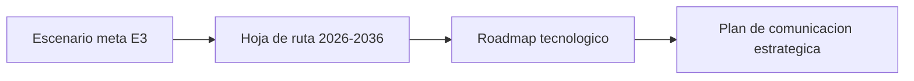

# 📘 Tercera Entrega: Actividad No. 3 – Análisis Prospectivo de Imaginamos S.A.S. 2036

Esta carpeta contiene la **versión final** del informe de la **tercera entrega (Actividad No. 3)** del Grupo 9 para el módulo **Pensamiento Estratégico y Prospectiva** del Politécnico Grancolombiano, presentado el **4 de noviembre de 2026**.
El informe integra en un solo documento las tres entregas: presentación de la empresa, matriz de 30 variables, marco de referencia, simulación prospectiva y propuesta estratégica a 2036.
Cierra con 20 conclusiones, las referencias bibliográficas y el enlace a este repositorio del proyecto en GitHub.

## 📄 Archivo del informe

| Archivo | Descripción |
|:---|:---|
| `Desarrollo_U1_Pensamiento_Estrategico_y_Prospectiva_Actividad_No_3.pdf` | 📘 Informe final de la tercera entrega (Actividad No. 3) |

> ℹ️ La versión editable en Word (`.docx`) sigue excluida por `.gitignore` y permanece solo en local.

## 🧩 Contenido del informe

| Sección | Contenido |
|:---|:---|
| 🏢 **Presentación de la empresa** | Ficha técnica, evolución histórica, modelo de negocio, portafolio, contexto sectorial y cinco fuerzas de Porter |
| 📊 **Matriz general de 30 variables** | Análisis IGO, plano IGO y ranking de las 10 variables clave |
| 🌐 **Marco de referencia** | PESTEL · Análisis interno · Cadena de valor · Clúster de software y TI |
| 🕸️ **Simulación prospectiva** | Ranking · Matriz de impactos cruzados · MIC-MAC · Hipótesis · Escenarios · Escenario meta |
| 🎯 **Propuesta estratégica** | Misión, visión 2036 y valores · Océano azul · Modelo Delta · Matriz BCG · Objetivos y metas · Planes de contingencia · Hoja de ruta 2026-2036 · Roadmap tecnológico · Plan de comunicación estratégica |
| ✅ **Conclusiones y referencias** | 20 conclusiones, referencias bibliográficas y enlace al repositorio |

## 🕸️ Resultados de la simulación

| Hallazgo | Resultado |
|:---|:---|
| 💪 **Zona de poder** | 1 variable (según los umbrales del simulador) |
| ⚡ **Zona de conflicto** | 8 variables |
| 🎯 **Variable de resultado** | 1 variable: ingresos concentrados en proyectos |
| 🔁 **Escenarios repetidos** | Los escenarios 2, 5 y 8 repiten a los 1, 4 y 7: el simulador entrega **siete configuraciones distintas** |
| 🔮 **Escenario meta (E3)** | **48,33 %** según el simulador |

> ℹ️ Condicionado a su propia hipótesis de brecha de talento, el escenario 3 tendría una probabilidad del **42,22 %**. Por eso se selecciona como **escenario apuesta** por su coherencia, verosimilitud y deseabilidad, no por ser el más probable.

## 🚀 Novedades de la propuesta estratégica

| Componente | Qué define |
|:---|:---|
| 🛠️ **Roadmap tecnológico** | Necesidad · Capacidad · Tecnología · Proyectos · Responsable · Resultado esperado |
| 📣 **Plan de comunicación estratégica** | Públicos · Mensajes · Canales · Acciones · Responsables · Indicadores |

## 📦 Anexos

Los anexos se entregan en un `.zip` aparte, que no se versiona en el repo:

<b>🔎 Ver los archivos del .zip de anexos</b>

- 🧮 `Simulador_Prospectiva_Imaginamos.xlsm`
- 📊 `Matriz_IGO_Imaginamos.xlsx`
- 📋 `VariablesIniciales.xlsx`
- 🏆 `RankingVariables.xlsx`
- 📈 `GraficaMicMac.png`
- ⚖️ `PoderConflicto.xlsx`
- 🔹 `MatrizHipotesisDepBaja.xlsx`
- 🔸 `MatrizHipotesisDepAlta.xlsx`
- 🔮 `ListaEscenarioMeta.xlsx`
- 🎯 `Escenario_Meta.xlsx`
- 🎓 `Diploma_didáctico.pdf`

> ℹ️ Las metas intermedias y la ubicación en la matriz BCG son la propuesta del equipo con base en información pública y se revisan cada año junto con los escenarios.

---

⬅️ Volver al [README principal](../README.md)
